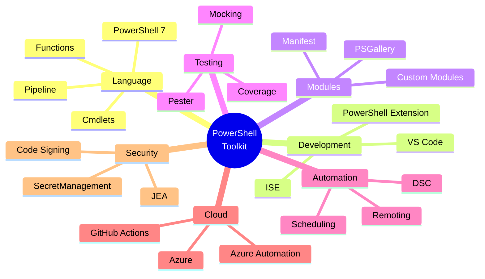

<div align="center">
    <p align="center">
        <a href="https://github.com/PowerShell/PowerShell">
          
        </a>
    </p>

# [PowerShell](https://learn.microsoft.com/powershell/) [Toolkit](https://github.com/cybersecurity-dev/awesome-powershell-scripting-resources): A Versatile Toolset for [Windows](https://github.com/cybersecurity-dev/awesome-powershell-scripting-language)
</div>

[](https://github.com/cybersecurity-dev/awesome-powershell-scripting-language) 
[](https://youtube.com/playlist?list=PL9V4Zu3RroiXaZk_Y8215qPHieeH639VA&si=jzE2_cwYKyi8du3O) 
[](https://www.reddit.com/r/PowerShell/new/)

<p align="center">
    <a href="https://github.com/cybersecurity-dev/"></a>
    &nbsp;
    <a href="https://www.youtube.com/@CyberThreatDefense"></a>
    &nbsp;
    <a href="https://cyberthreatdefence.com/my_awesome_lists"></a>
    
</p>



## 📖 Contents
- [My Awesome Lists](#my-awesome-lists)
- [Contributing](#contributing)
- [Contributors](#contributors)

## Network Tools

```powershell
Get-NetConnectionProfile 
Set-NetConnectionProfile -Name "NetworkName" -NetworkCategory Private #(Public)
```

## Add a function

```powershell
notepad $PROFILE
#if you got error:
New-Item -ItemType File -Path $PROFILE -Force
notepad $PROFILE
```
Adding function:
```
function ssh_remoteserver {
    ssh username@remoteserver
}
```
Apply immediately:
```powershell
. $PROFILE
#if you got error:
Set-ExecutionPolicy -Scope CurrentUser RemoteSigned
. $PROFILE
```


## Useful PowerShell "aliases"
* Quick directory listing (like ll in Linux):
    ```powershell
    Set-Alias ll Get-ChildItem
    ```
* Detailed directory listing
    ```powwrshell
    function la { Get-ChildItem -Force }
    ```
* Go up one directory
    ```powershell
    function .. { Set-Location .. }
    ```
* Go up two directories
    ```powershell
    function ... { Set-Location ../.. }
    ```
* Open current folder in Explorer:
    ```powershell
    function open { explorer . }
    ```
* Clear screen:
    ```powershell
    Set-Alias c Clear-Host
    ```

##

### My Awesome Lists
You can access the my awesome lists [here](https://cyberthreatdefence.com/my_awesome_lists)

### Contributing
[Contributions of any kind welcome, just follow the guidelines](contributing.md)!

### Contributors
[Thanks goes to these contributors](https://github.com/cybersecurity-dev/PowerShell-Toolkit/graphs/contributors)!

[🔼 Back to top](#powershell-toolkit-a-versatile-toolset-for-windows)
